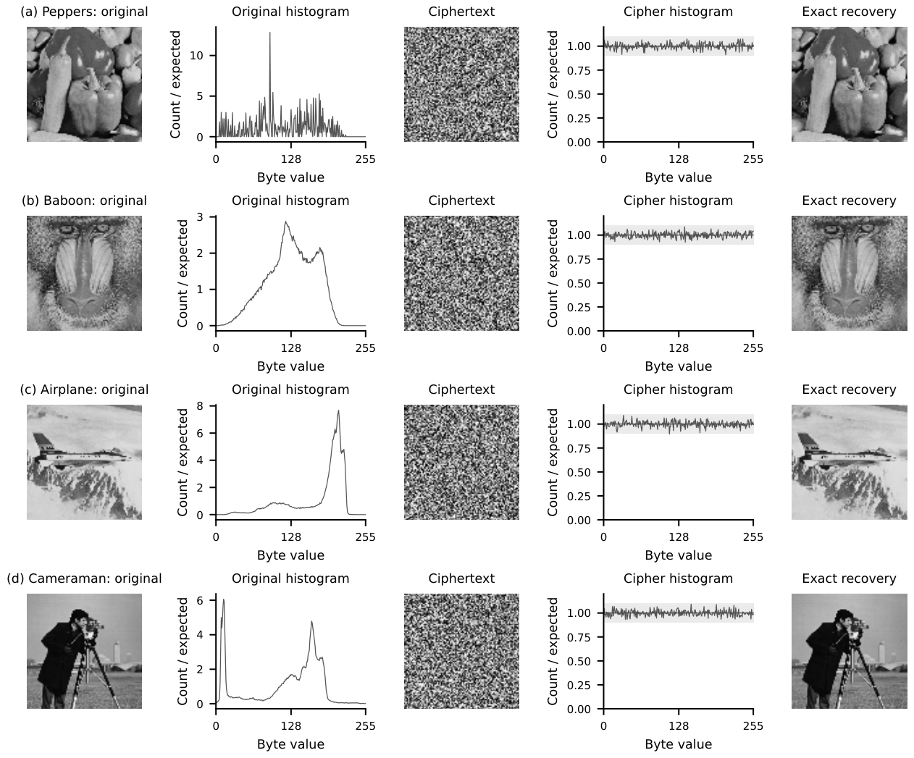
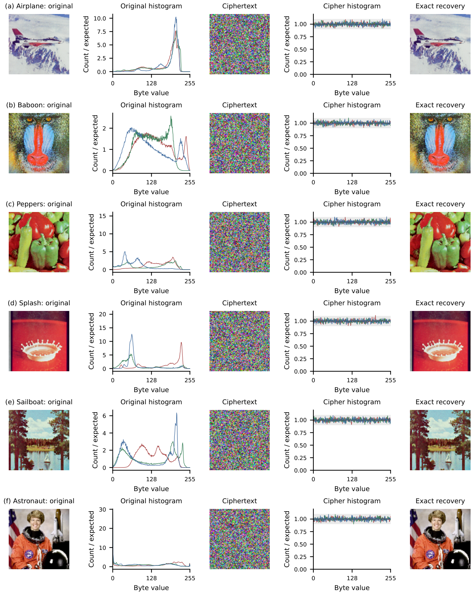
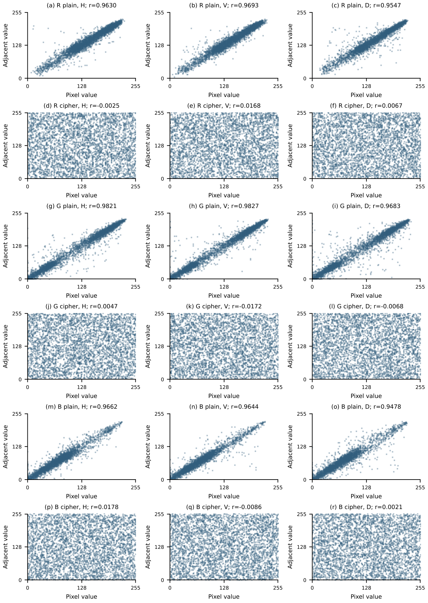
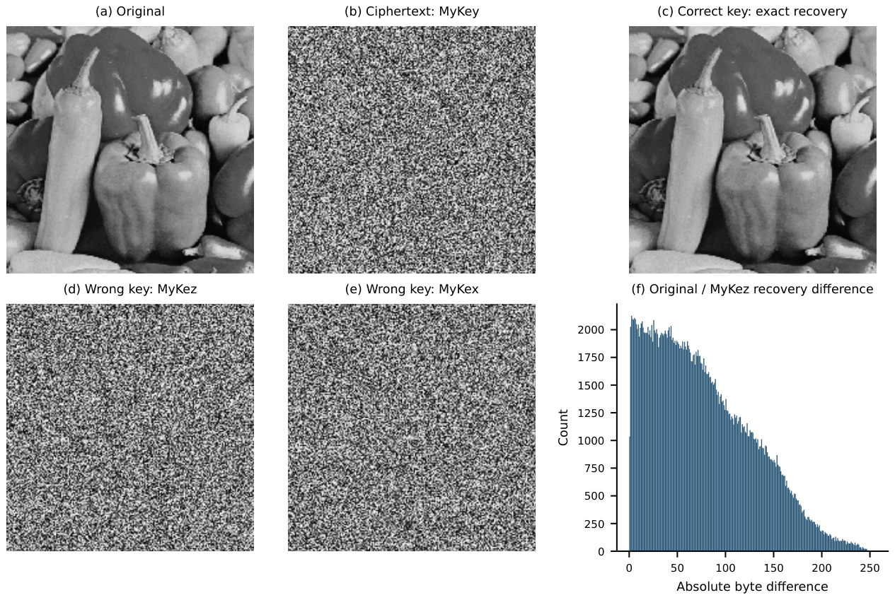

# Image Encryption Driven by Coupled Chaotic Maps with Reversible Multiplicative Diffusion

Wei Gao and Huanhuan Wu

Supplementary results for the grayscale and RGB image benchmarks. [Download the complete supplement](Supplementary_Materials.pdf).

## Figure S1. Grayscale encryption, recovery and histograms

Encryption and exact recovery for four of the eight grayscale benchmark images at 512 × 512 pixels with a burn-in of 100 updates. Ciphertext histograms are normalized by the uniform expected count. Shading indicates ±3σ. Panels show the original, its histogram, the ciphertext, its histogram and the recovered image.

## Figure S2. RGB encryption, recovery and histograms

Encryption and exact recovery of six 512 × 512 RGB images at the same burn-in. Histograms are normalized by the uniform expected count. Shading indicates ±3σ. RGB histograms are shown separately by channel.

## Figure S3. Adjacent-pixel correlations

Adjacent-pixel scatter for Peppers. Columns show horizontal, vertical and diagonal pairs. Paired rows show plaintext and ciphertext for each RGB channel. Each panel gives the correlation for 4000 pairs sampled at matching coordinates. Pairs were drawn without replacement using NumPy PCG64 with seed 20260918. The same coordinates were used for plaintext and ciphertext within each channel and direction.

## Figure S4. Password sensitivity and wrong-password recovery

Password sensitivity for 512 × 512 Peppers. Panels (a–f) show the original, ciphertext, correct-password recovery, recovery with MyKez and MyKex, and the absolute difference between (a) and (d), respectively. The plaintext and public salt were held fixed. The correct password was MyKey; the two one-character variants were MyKez and MyKex.

## Table S1. Per-image benchmark results

Entropy is measured in bits per byte. RGB rows give mean channel entropy and the smallest channel-wise chi-square p-value. NPCR and UACI average 27 grayscale perturbations or 45 affected-plane comparisons per RGB image across three passwords.

| Modality | Image | Entropy | p | NPCR (%) | UACI (%) |
| --- | --- | --- | --- | --- | --- |
| Grayscale | Airplane | 7.9993 | 0.4809 | 99.6112 | 33.4519 |
| Grayscale | Baboon | 7.9994 | 0.8069 | 99.6110 | 33.4800 |
| Grayscale | Barbara | 7.9993 | 0.5233 | 99.6124 | 33.4558 |
| Grayscale | Boat | 7.9993 | 0.3737 | 99.6083 | 33.4672 |
| Grayscale | Cameraman | 7.9993 | 0.6025 | 99.6077 | 33.4533 |
| Grayscale | Gray21 | 7.9993 | 0.4839 | 99.6101 | 33.4479 |
| Grayscale | Peppers | 7.9993 | 0.3537 | 99.6088 | 33.4501 |
| Grayscale | Ruler | 7.9993 | 0.7315 | 99.6108 | 33.4839 |
| RGB | Airplane | 7.9993 | 0.0946 | 99.6106 | 33.4726 |
| RGB | Astronaut | 7.9993 | 0.4898 | 99.6082 | 33.4839 |
| RGB | Baboon | 7.9994 | 0.7778 | 99.6111 | 33.4605 |
| RGB | Peppers | 7.9993 | 0.0697 | 99.6105 | 33.4571 |
| RGB | Sailboat | 7.9993 | 0.1271 | 99.6091 | 33.4638 |
| RGB | Splash | 7.9994 | 0.7146 | 99.6135 | 33.4556 |
| Grayscale | Gray mean (216) | 7.999307576 | -- | 99.610039 | 33.461227 |
| RGB | RGB mean (270) | 7.999312391 | -- | 99.610498 | 33.465580 |

[Download Table S1](tables/Table_S1.csv)
